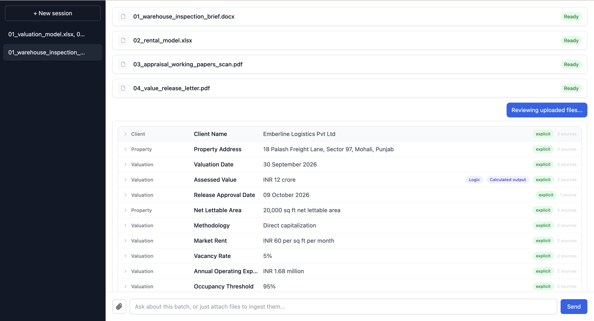
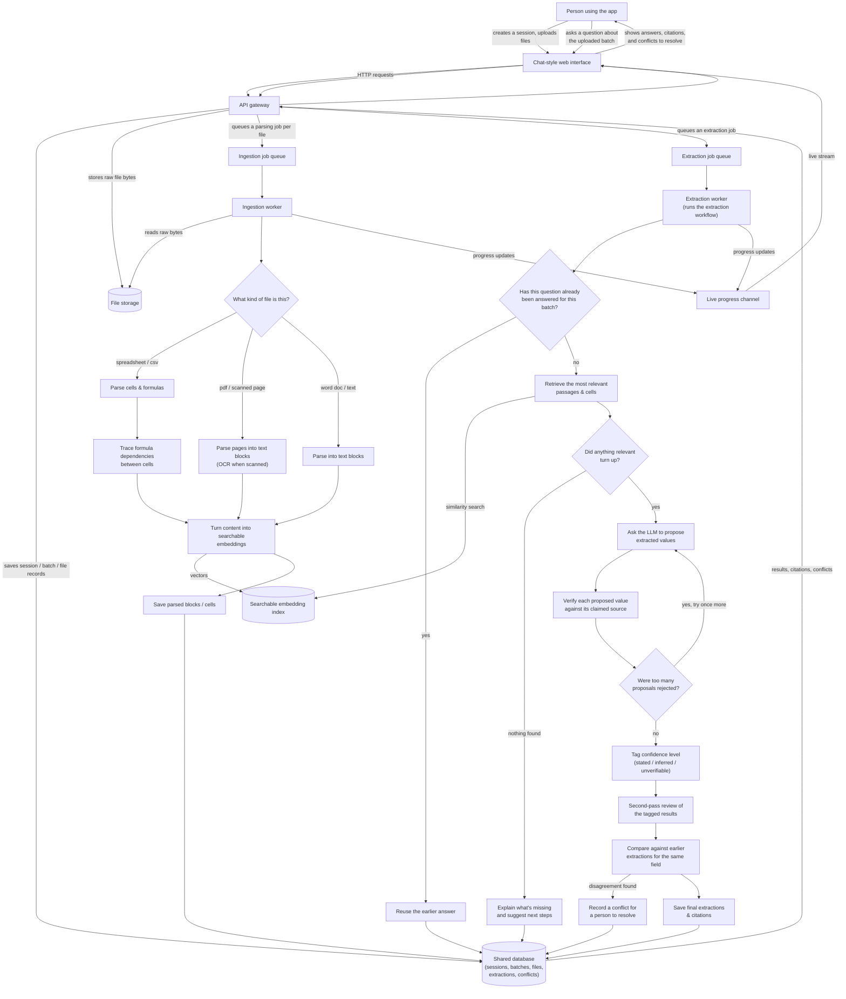

# Valuation Extraction System

This project helps a valuation team make sense of a messy pile of documents — appraisal
reports, scanned surveys, rental models, cost spreadsheets — by pulling out the actual
numbers and facts they need, tracing every answer back to the exact page or cell it came
from, and flagging the moments where two documents disagree with each other.

Think of it as a research assistant that never skims: it reads everything in a batch of
files, remembers where every fact lives, and only answers a question once it can back that
answer up with a citation.



## What it actually does

You open a session, drop in a folder's worth of files (PDFs, scans, Excel workbooks, CSVs,
Word docs, plain text), and ask a question like *"what's the net rentable area?"* or *"list
every valuation figure across these reports."* Behind the scenes the system:

1. Parses each file into a common shape — text blocks for documents, cells and formulas for
   spreadsheets — and remembers exactly where each piece of text or number sits.
2. Embeds that content so it can be searched by meaning, not just keyword.
3. When you ask a question, retrieves the most relevant passages, asks an LLM to propose
   extracted values, and then independently double-checks each proposed value against its
   claimed source before it's allowed to be shown to you.
4. Tags each surviving value with how confident it is (directly stated vs. inferred vs.
   unverifiable), checks it against anything already extracted for the same field, and
   raises a conflict if two sources disagree.
5. Streams progress back to the UI the whole time, so you see "parsing," "reading file 3 of
   7," "checking citations," etc. rather than a silent spinner.

Duplicate uploads are recognized by content (not filename), so the same source document
dropped into two different sessions is parsed once and reused everywhere else.

## Current status

The session/batch/file lifecycle, uploads, and the chat-style frontend are fully wired up
end to end. The parsing pipeline (PDF/scan/spreadsheet/docx/csv/text), the LLM extraction
pipeline (retrieval, proposal, citation verification, conflict detection), and the
evaluation/benchmark suite are all implemented and running — this isn't a stub, it's the
real pipeline described below.

## How data flows through the system



**Reading the diagram:**

- The top half is **ingestion** — turning raw uploaded files into searchable, structured
  content, happening once per file.
- The bottom half is **extraction** — turning a natural-language question into verified,
  cited answers, happening once per question and reusable across the batch.
- Both halves report progress through the same live channel, which is how the interface
  shows real-time status instead of a blank loading screen.
- Every answer that reaches the user carries a citation back to its source, and every
  disagreement between sources becomes a conflict a person has to resolve rather than a
  silently overwritten value.

## Tech stack

| Area | What it does | Built with |
|---|---|---|
| Web interface | Chat-style UI for sessions, uploads, questions, live progress, citations & conflicts | React 18, TypeScript, Vite, Tailwind CSS, TanStack Query |
| API gateway | HTTP layer, auth/tenant scoping, request validation, SSE progress endpoints | FastAPI, Pydantic, python-multipart, sse-starlette, Uvicorn |
| Shared database | Sessions, batches, files, extractions, citations, conflicts, embeddings | PostgreSQL, SQLAlchemy, Alembic (migrations), pgvector (embedding storage) |
| File storage | Raw uploaded file bytes, deduped by content hash | Local object store (disk-backed) |
| Job queues & progress | Background job dispatch for ingestion/extraction; live step-by-step progress stream | Celery, Redis (broker + pub/sub for progress) |
| Ingestion workflow | File-type parsing, OCR, formula-dependency tracing, embedding | PyMuPDF (PDF), Tesseract via pytesseract (OCR on scans), python-docx (Word), openpyxl (Excel/CSV), NetworkX (formula graph), LangChain OpenAI embeddings |
| Extraction workflow | Retrieval, LLM proposal, citation verification, confidence tagging, conflict detection | LangGraph (stateful workflow/graph orchestration), LangChain, OpenAI (LLM calls) |

## Project layout

```
.
├── api/                  # FastAPI app: routers, request/response schemas, auth dependency
│   ├── routers/          # sessions, batches, files, extractions, conflicts
│   └── schemas/          # Pydantic models for request/response bodies
├── core/                 # Config, DB session/engine, SQLAlchemy models, tenant auth stub
│   └── models/           # session, batch, file, extraction, citation, conflict, etc.
├── ingestion/            # Celery worker: parses uploaded files into blocks/cells + embeddings
│   ├── nodes/            # one module per parse step (pdf, docx, spreadsheet, csv, text, formulas, embed, persist)
│   └── tasks/            # Celery task entrypoints
├── extraction/           # Celery worker: the LangGraph extraction workflow
│   ├── nodes/            # one module per graph step (retrieve, propose, verify, tag, review, conflicts, persist, cache)
│   └── tasks/            # Celery task entrypoints
├── progress/             # Redis pub/sub helper that streams live step-by-step progress
├── storage/              # File storage (local disk) + content-hash helpers for dedup
├── migrations/           # Alembic schema migrations
├── frontend/             # React/TypeScript/Tailwind chat-style UI (see below)
├── tests/                # Pytest unit tests for the ingestion/extraction nodes
├── docs/                 # Sample and test-pack files used for manual testing
├── docker/               # Dockerfiles for the api, worker, and frontend images
├── docker-compose.yml        # Production-style compose stack
├── docker-compose.dev.yml    # Dev overrides (bind mounts, watch, reload)
└── pyproject.toml        # Python package & dependency definitions
```

## Frontend setup

The frontend is a small React + TypeScript single-page app (Vite + Tailwind), talking to
the API over plain HTTP and Server-Sent Events for live progress.

```
frontend/
├── index.html
├── vite.config.ts        # dev server on port 5173
├── tailwind.config.ts
├── tsconfig.json
└── src/
    ├── main.tsx           # app entrypoint
    ├── App.tsx            # top-level layout: sidebar + chat
    ├── index.css          # Tailwind entrypoint
    ├── api/
    │   └── client.ts      # fetch wrapper, typed API responses, SSE query helpers
    ├── lib/
    │   ├── extractionGrouping.ts   # groups raw extraction results for display
    │   └── downloadReport.ts       # builds the downloadable report
    └── components/
        ├── Sidebar.tsx              # session/batch list and switcher
        ├── Composer.tsx             # chat input for asking questions / uploading files
        ├── FileAttachmentCard.tsx   # uploaded file preview + status
        ├── ProgressStepper.tsx      # live ingestion/extraction progress UI
        ├── ExtractionTurn.tsx       # one question/answer turn in the chat
        ├── ExtractionResultCard.tsx # a single extracted value + citation + confidence
        └── DownloadReportButton.tsx # exports results as a report
```

By default it talks to `http://localhost:8000`. To point it at a different API, set
`VITE_API_BASE_URL` (e.g. in a `frontend/.env.local` file):

```bash
echo "VITE_API_BASE_URL=http://localhost:8000" > frontend/.env.local
```

To run it on its own against a locally running API:

```bash
cd frontend
npm install
npm run dev          # starts Vite on http://localhost:5173
```

Identity is currently stubbed — the frontend sends a fixed tenant/user id via headers (or
query params for the SSE endpoints, since `EventSource` can't set custom headers), matching
the header-based auth stub on the backend. There's no login screen yet.

## Running it locally

```bash
cp .env.example .env   # fill in your OpenAI API key
docker compose up --build
```


Once it's running:

- API: http://localhost:8000 (interactive docs at `/docs`)
- Frontend: http://localhost:5173

## Running without Docker

```bash
pip install -e .
alembic upgrade head          # needs Postgres running, e.g. `docker compose up postgres`
uvicorn api.main:app --reload

# in another shell, the ingestion worker
celery -A ingestion.celery_app worker --loglevel=info -Q ingestion

# in another shell, the extraction worker
celery -A extraction.celery_app worker --loglevel=info -Q extraction

# in another shell, the frontend
cd frontend && npm install && npm run dev
```

Need to update DATABASE_URL as well in .env if not using postgres from inside Docker